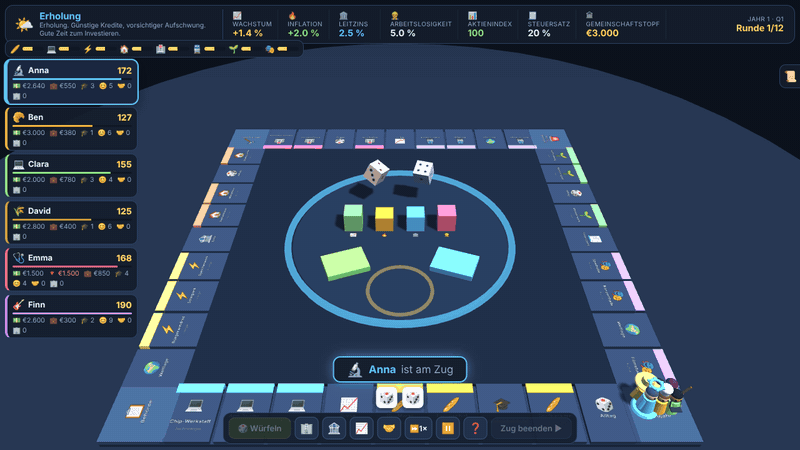
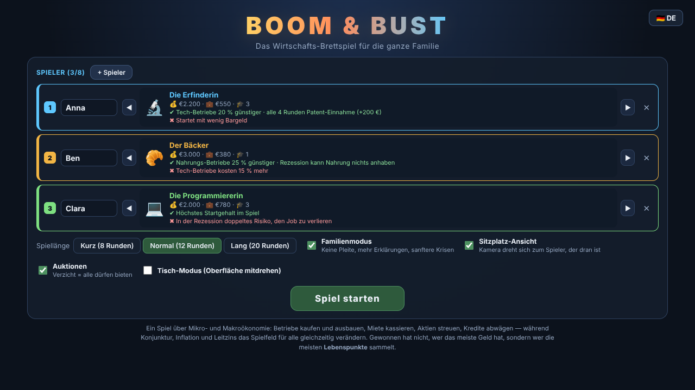
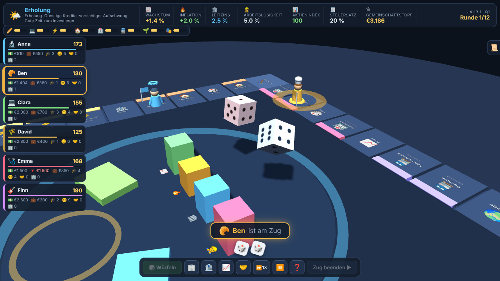

# BOOM & BUST 🎲📈

**A 3D economics board game for the whole family — 2 to 8 players, runs offline in the browser.**

[](https://hybrid333.github.io/boom-and-bust/)




## In English

BOOM & BUST is a remix of *The Game of Life* and *Monopoly* that quietly teaches real micro- and macroeconomics. You don't win by having the most money — you win by collecting the most **life points**: wealth + education + joy + common good + children.

- **A living economy.** Every year the simulation runs the real causal chain: player spending drives growth → growth lowers unemployment (Okun) → tight labour pushes inflation (Phillips) → the central bank answers with the policy rate (Taylor rule) → rates slow next year's growth. Four live pillars in the middle of the board show it happening.
- **Micro-lessons built into every move:** diminishing returns on upgrades, supply and demand in rents, monopoly premiums (and an antitrust vote against them), opportunity cost, auctions, risk vs. return, insurance, diversification, compound interest and the debt spiral.
- **Explains itself.** Every rent is broken down ("why exactly this amount?") and every card carries an economics tip.
- **Made for a real table:** the camera turns to whoever's turn it is; in table mode the whole UI rotates, for a laptop lying flat between players.
- **8 characters**, each with a real strength *and* a real weakness. Family mode removes bankruptcy and softens crises.
- **Demo mode** 🤖 lets the computer play, so you can learn the rules by watching.
- **Fully bilingual** — German and English, switchable at any time.

**Play:** [hybrid333.github.io/boom-and-bust](https://hybrid333.github.io/boom-and-bust/) — or download the repo and open `index.html`. No server, no internet, no install.

**Tech:** plain JavaScript with classic `<script>` tags, so it even runs from `file://`. three.js is vendored locally. Every animation has a wall-clock brake, so a turn never hangs when the browser throttles a background tab. Tested with 2–8 players through complete games in both languages.

| Start screen | Mid-game |
|---|---|
|  |  |

---

## Auf Deutsch

**Das 3D-Wirtschafts-Brettspiel für die ganze Familie — 2 bis 8 Spieler.**
Ein Remix aus *Spiel des Lebens* und *Monopoly*, der nebenbei echte Mikro- und
Makroökonomie beibringt. Läuft komplett offline im Browser, ohne Installation.

> Gewonnen hat **nicht**, wer das meiste Geld hat, sondern wer die meisten
> **Lebenspunkte** sammelt: Vermögen + Bildung + Freude + Gemeinwohl + Kinder.

---

### Starten

Doppelklick auf **BOOM & BUST** auf dem Desktop.
Alternativ: `Play BOOM AND BUST.bat` oder `index.html` direkt öffnen.

Kein Server, kein Internet, keine Installation nötig — three.js liegt lokal
unter `vendor/`.

---

### Was das Spiel besonders macht

| | |
|---|---|
| 🔄 **Sitzplatz-Ansicht** | Die Kamera dreht sich zu dem Spieler, der dran ist. Im **Tisch-Modus** dreht sich sogar die Oberfläche mit — ideal, wenn der Laptop flach auf dem Tisch liegt. |
| 🔍 **Automatischer Zoom** | Beim Würfeln fährt die Kamera an die Würfel, beim Ziehen folgt sie der Figur, beim Landen zoomt sie auf das Feld. |
| 🧍 **8 einzigartige Figuren** | Jede mit eigenem 3D-Modell, eigener Stärke und einer echten Schwäche. |
| 📊 **Lebende Wirtschaft** | In der Brettmitte zeigen vier Säulen live Wachstum, Inflation, Leitzins und Arbeitslosigkeit. Der Ring färbt sich nach Konjunkturlage. |
| 💡 **Erklärt sich selbst** | Jede Miete wird aufgeschlüsselt: Warum genau dieser Betrag? Jede Karte bringt einen Wirtschafts-Tipp. |
| 🤖 **Demo-Modus** | Knopf 🤖 lässt den Computer spielen — gut, um die Regeln beim Zuschauen zu lernen. |
| 🇩🇪🇬🇧 **Zweisprachig** | Komplett auf Deutsch und Englisch, jederzeit umschaltbar. |

---

### Der Zug

1. **Würfeln** — zwei Würfel, Pasch bedeutet nochmal. Dreimal Pasch → ab zur Behörde.
2. **Ziehen** — die Figur hüpft Feld für Feld, die Kamera folgt.
3. **Feld auflösen** — kaufen, Miete zahlen, Karte ziehen, Kurs belegen …
4. Jederzeit möglich: **Bank**, **Börse**, **Besitz ausbauen**, **spenden**.
5. **Zug beenden.**

Jede Runde = ein **Quartal**. Vier Quartale = ein **Jahr**. Am Jahresende
dreht sich die Konjunktur und alle stimmen über die Wirtschaftspolitik ab.

---

### Was hier tatsächlich gelehrt wird

#### Mikroökonomie — deine eigenen Entscheidungen

* **Abnehmender Grenzertrag** — jede Ausbaustufe kostet mehr und bringt anteilig
  weniger. Die Rendite steht im Dialog: 25 % → 20 % → 15 % → 10 %.
* **Angebot & Nachfrage** — je mehr Betriebe in einem Sektor bespielt werden,
  desto weniger Miete kann jeder einzelne verlangen.
* **Monopol** — wem ein ganzer Sektor gehört, kassiert ×1,55. Genau deshalb
  gibt es Kartellbehörden (und eine Wahloption dagegen).
* **Opportunitätskosten** — viele Karten zwingen zu einer echten Wahl:
  Nebenjob *oder* Freizeit, Kind *oder* Karriere, reparieren *oder* neu kaufen.
* **Preisfindung** — bei Auktionen entsteht der Preis erst durch die Bietenden.
* **Risiko & Rendite**, **Versicherung**, **Diversifikation** (ab 4 Sektoren
  im Depot), **Zinseszins** und die **Schuldenspirale**.

#### Makroökonomie — die Welt um dich herum

Die Simulation rechnet jedes Jahr in der Reihenfolge, in der es auch
in echt funktioniert:

1. Die Ausgaben der Spieler treiben das **Wachstum** (Nachfrage).
2. Wachstum senkt die **Arbeitslosigkeit** *(Okun)*.
3. Knappe Arbeit treibt die **Inflation** *(Phillips)*.
4. Die Zentralbank reagiert mit dem **Leitzins** *(Taylor-Regel)*.
5. Der Zins bremst im nächsten Jahr das Wachstum — der Kreis schließt sich.

Daraus entstehen die vier Phasen **Erholung → Boom → Überhitzung → Rezession**,
die auf jede Miete, jeden Kredit und jeden Aktienkurs durchschlagen.
Dazu: Preisniveau (deine Kaufkraft sinkt still), Steuern und Gemeinschaftstopf,
Sektorschocks und **Wahlen**, bei denen die Mehrheit für *alle* entscheidet.

Das ist der eigentliche Punkt des Spiels: **Du triffst gute Entscheidungen —
und wirst trotzdem von der Weltlage getroffen.**

---

### Die Figuren

| Figur | Stärke | Schwäche |
|---|---|---|
| 🔬 Die Erfinderin | Tech −20 %, Patenteinnahmen | wenig Startgeld |
| 🥐 Der Bäcker | Nahrung −25 %, krisenfest | Tech +15 % |
| 💻 Die Programmiererin | höchstes Startgehalt | doppeltes Jobverlust-Risiko |
| 🌾 Der Landwirt | Boom-Bonus auf Nahrung + Energie | Wetterkarten treffen doppelt |
| 🩺 Die Ärztin | nie arbeitslos, Gesundheit −20 % | 1 500 € Studienkredit |
| 🎸 Der Musiker | sehr glücklich, Kultur −25 % | niedrigstes Gehalt |
| 🏗️ Die Bauunternehmerin | Ausbau −25 %, Wohnen −20 % | +2 % Kreditzins |
| ♻️ Die Klimaschützerin | Umwelt −30 %, klimafest | Energie bringt weniger |

---

### Einstellungen

* **Spiellänge** — 8 / 12 / 20 Runden
* **Familienmodus** — keine Pleite, sanftere Krisen, mehr Erklärungen
* **Sitzplatz-Ansicht** — Kamera dreht sich zum aktiven Spieler
* **Tisch-Modus** — die Oberfläche dreht sich mit
* **Auktionen** — Verzicht auf einen Kauf lässt alle mitbieten
* **⏩ Tempo** — 1× bis 3×, für ungeduldige Mitspieler

---

### Dateien

```
index.html          Oberfläche, Gestaltung, Einstiegspunkt
js/data.js          Spielfeld, Figuren, Kartendecks, Politik, Übersetzungen
js/econ.js          Wirtschaftssimulation (Makro + Preisformeln)
js/game.js          Regeln, Zugablauf, Karteneffekte
js/scene.js         three.js: Brett, Figuren, Würfel, Kamera
js/ui.js            HUD, Dialoge, Auktion, Wahl, Auswertung
vendor/three.min.js three.js r128 (lokal, für Offline-Betrieb)
make_icon.py        erzeugt icon.ico / icon.png
```

#### Praktische URL-Parameter

* `?nocache=1` — erzwingt frische Skripte beim Weiterentwickeln
* `?demo=6` — startet sofort ein Spiel mit 6 Figuren
* `?demo=6&autoplay=1` — plus Demo-Modus

---

### Technische Hinweise

* Reines JavaScript ohne Build-Schritt, klassische `<script>`-Tags —
  läuft deshalb auch direkt über `file://`.
* Jede Animation hat zusätzlich eine Uhrzeit-Bremse. Browser drosseln die
  Render-Schleife in Hintergrund-Tabs; ohne dieses Netz würde ein Spielzug
  dort hängenbleiben. Wegklicken und Zurückkommen ist damit gefahrlos.
* Getestet mit 2–8 Figuren über komplette Partien, auf Deutsch und Englisch.

## Lizenz / License

[MIT](LICENSE) — three.js (`vendor/three.min.js`) steht unter seiner eigenen MIT-Lizenz. / three.js is under its own MIT license.
